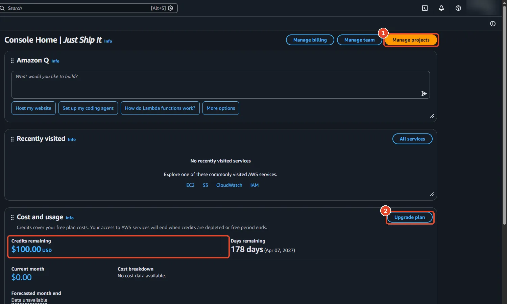
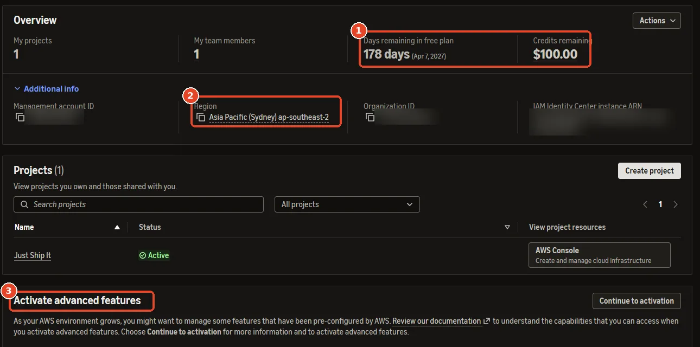

# AWS account

This page creates the club's AWS account, protects its master login, and gives you an everyday login of your own. All three parts happen in a web browser, so each one has a screen recording followed by the same steps in writing.

Before you start, make sure you have these three things:

- An email address that the club controls, such as `infra@<club-domain>` or a shared Gmail account. Avoid a personal address, because the account has to outlive your time on the committee.
- A credit or debit card, which AWS bills once a month.
- A phone that can receive text messages, which AWS uses to check your identity.

!!! danger "The root user can do anything"
    The email and password you sign up with become the account's **root user**, which can spend money, delete everything and close the account. Once you finish part 3 you won't need it day to day. Keep its password in the club's password manager, and never paste it into a chat.

## Part 1: Sign up

--8<-- "rec-pending.md"

1. Open <https://signin.aws.amazon.com/signup?request_type=register>.
2. Enter the club email and an account name, such as `whitehacks-2027`, and click **Verify email address**.
3. Enter the code that AWS emails to you, and then choose a strong password.
4. Choose the **Paid plan**. The Free plan can block services that this system needs, and it closes the account after six months, whereas the Paid plan still gives you the sign-up credits.
5. Under **Contact information**, choose **Personal** and fill in your name, phone number and address.
6. Enter the card details. AWS may place a temporary hold of about US$1 to check the card.
7. Choose **Text message (SMS)** and enter the code you receive.
8. Choose **Basic support – Free**, and then click **Complete sign up**.

**Check it worked:** within a few minutes you receive an email titled *Welcome to Amazon Web Services*. Some services can take up to a day to switch on, so if a later command fails with `SubscriptionRequiredException` or `OptInRequired`, wait an hour and try it again.

## Which kind of account you have

AWS now creates some new accounts as a **Free-plan project**, which is an account that AWS manages for you inside a small organisation of its own. This guide was tested on one of these accounts, and as it comes, such an account can't run the system, for the reasons in this table.

| Limit | What fails |
|---|---|
| Only one region, chosen by AWS | Commands in any other region fail with `explicit deny in a service control policy`. |
| No OIDC provider | `make deploy-eks` fails with `not authorized to perform: iam:CreateOpenIDConnectProvider`. |
| Only "Free Tier eligible" computer sizes | The cluster's computers never start, and the error says `not eligible for Free Tier`. |
| No domain purchases in Route 53 | Option A on the [Domain name](domain.md) page doesn't work. |

[Prepare the account](prepare.md) lifts all four limits in about 15 minutes, so do it before anything else.

To find out which kind of account you have, open the console. A Free-plan project shows **Manage projects** and **Upgrade plan** on its home page:

<figure class="shot" markdown>

<figcaption>(1) Manage projects opens AWS Settings. (2) Upgrade plan switches to the Paid plan. The box shows the credits left.</figcaption>
</figure>

Clicking **Manage projects** shows the account's region:

<figure class="shot" markdown>

<figcaption>(1) Days and credits left on the Free plan. (2) The only region this account may use. (3) Activating advanced features lifts the region limit, but it can't be undone and requires the Paid plan first.</figcaption>
</figure>

Once you have [signed in from the terminal](cli-login.md), you can also print the region there with `aws configure get region`.

## Part 2: Protect the root user with a second factor

With a second factor, a stolen password on its own can't open the account, because signing in also needs a phone app or a security key.

--8<-- "rec-pending.md"

1. Sign in at <https://console.aws.amazon.com/>. Choose **Root user** and enter the club email and password.
2. Click the account name at the top right, and then click **Security credentials**.
3. Under **Multi-factor authentication (MFA)**, click **Assign MFA device**.
4. Give the device a name, for example `root-alex`. Choose **Authenticator app** to use an app such as Google Authenticator or Microsoft Authenticator, or choose **Passkey or security key** if you have one.
5. If you chose an app, scan the QR code with it, and then type in two codes from the app in a row.

**Check it worked:** the MFA table lists one device. When you sign out and sign in again, AWS now asks for a code after the password.

## Part 3: Create your everyday login

!!! note "Skip this part after [Prepare the account](prepare.md)"
    Preparing the account already sets up logins through your AWS Builder ID. Go straight to [Prepare the account](prepare.md), and then use `aws login` as described in [Sign in from the terminal](cli-login.md#accounts-prepared-through-aws-settings).

You'll create a personal login through **IAM Identity Center**, the AWS service that manages people's logins. It gives the terminal temporary passwords that expire after a few hours, so a password that leaks stops working on its own.

--8<-- "rec-pending.md"

1. While you are still signed in as root, check the region name at the top right. It should say **Asia Pacific (Singapore)**, or on a Free-plan project, the region shown in AWS Settings. If it shows something else, click it and choose that region.
2. Type **IAM Identity Center** into the search bar at the top, open it, and click **Enable**. If AWS asks, choose **Enable with AWS Organizations**.
3. In the left menu, click **Users** and then **Add user**. Use your first name as the username and enter your own email address, then click through to **Add user**.
4. In the left menu, click **Permission sets** and then **Create permission set**. A *permission set* is a named list of things a user may do. Choose **Predefined permission set → AdministratorAccess**, which allows everything except closing the account, set **Session duration** to **8 hours**, and click **Create**.
5. In the left menu, click **AWS accounts**. Tick the club account, click **Assign users or groups**, open the **Users** tab, tick your user and click **Next**. Then tick **AdministratorAccess** and click **Submit**.
6. In the left menu, click **Settings** and copy the **AWS access portal URL**, which looks like `https://d-xxxxxxxxxx.awsapps.com/start`. You'll need it on the next page.
7. Open the invitation email in your own inbox, click **Accept invitation**, choose a password, and set up a second factor when you are asked to.

**Check it worked:** open the access portal URL and sign in with your new login. The page should list the club account with **AdministratorAccess** under it.

!!! tip "Adding teammates"
    Repeat steps 3 and 5 for each person. Everyone gets a login of their own, so removing one person later doesn't affect anyone else.

**Next:** [Sign in from the terminal](cli-login.md).
