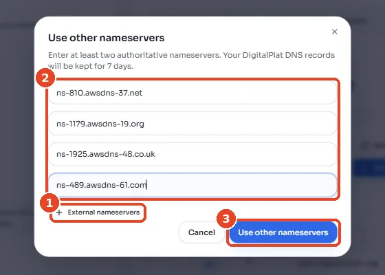

# Domain name

Players reach the CTF through names under the club's domain, with `ctf.<your-domain>` for the scoreboard and `<challenge>.challenges.<your-domain>` for each web challenge. The system creates those names by itself, but only if the domain's DNS records are kept in **Route 53**, which is AWS's DNS service. [The account and the domain](../concepts/account.md#the-domain-name) explains what a domain and DNS are, if you need a reminder.

There are two ways to set this up, so choose whichever option below fits your situation.

!!! tip "Reusing last year's domain"
    If the club already owns a domain in another AWS account, ask that account's owner to move it to yours with `aws route53domains transfer-domain-to-another-aws-account`, and then skip to [Check it worked](#check-it-worked).

## Option A: Buy the domain through Route 53

This is the simplest option, because Route 53 then sets up the DNS records for you.

!!! warning "Not available on the AWS Free plan"
    On a Free-plan account, every command below fails with `Free Tier accounts are not supported for this service`. Either [upgrade the plan](aws.md#which-kind-of-account-you-have) or use Option B.

Route 53's domain commands only work in the `us-east-1` region, so every command in this option names that region.

1. Check that the name is free and see its yearly price, replacing `example-ctf.com` with the name you want:
    ```bash
    DOMAIN=example-ctf.com
    aws route53domains check-domain-availability --region us-east-1 --domain-name "$DOMAIN"
    aws route53domains list-prices --region us-east-1 --tld "${DOMAIN##*.}" \
      --query 'Prices[0].RegistrationPrice'
    ```
    If you can buy the name, the first command prints `"Availability": "AVAILABLE"`.
2. Save the owner's contact details in a file, using the club's details rather than your own. The command in step 3 hides them from public lookups.
    ```bash
    cat > /tmp/contact.json <<'EOF'
    {"FirstName":"Infra","LastName":"Team","ContactType":"PERSON",
     "AddressLine1":"1 Example Street","City":"Singapore","CountryCode":"SG","ZipCode":"000000",
     "PhoneNumber":"+65.91234567","Email":"infra@example.com"}
    EOF
    ```
    The phone number has to use the form `+<country code>.<number>`.
3. Buy the domain. **This step charges the card.**
    ```bash
    aws route53domains register-domain --region us-east-1 \
      --domain-name "$DOMAIN" --duration-in-years 1 --auto-renew \
      --admin-contact file:///tmp/contact.json \
      --registrant-contact file:///tmp/contact.json \
      --tech-contact file:///tmp/contact.json \
      --privacy-protect-admin-contact --privacy-protect-registrant-contact --privacy-protect-tech-contact
    ```
    The output contains an `OperationId`, which you should copy for step 5.
4. Open the verification email that AWS sends to the contact address and click the link inside it. **If you skip this, the domain is suspended after 15 days.**
5. Check the progress, replacing `<OperationId>` with the value from step 3:
    ```bash
    aws route53domains get-operation-detail --region us-east-1 --operation-id <OperationId> --query Status
    ```
    Registration usually takes about 15 minutes, although it can take a day. When the output says `"SUCCESSFUL"`, Route 53 has also created the domain's hosted zone, which is where its DNS records live.

## Option B: Use a domain bought elsewhere

Use this option if the club bought the domain from another company, such as Namecheap or Cloudflare. You keep paying that company for the domain, but you move its DNS records to Route 53.

1. Create a hosted zone in Route 53. The command prints four **name servers**, which are the computers that will answer DNS questions for your domain:
    ```bash
    DOMAIN=example-ctf.com
    aws route53 create-hosted-zone --name "$DOMAIN" --caller-reference "$(date +%s)" \
      --query 'DelegationSet.NameServers'
    ```
2. Sign in to the other company's website and find the domain's nameserver settings, which are often under "custom nameservers". Replace the existing entries with the four names from step 1.

    <figure class="shot" markdown>
    { width="560" }
    <figcaption>An example at DigitalPlat. (1) Add fields until there are four, (2) paste in the four name servers, and (3) save. Other registrars have the same form under a different name.</figcaption>
    </figure>

For a test, a name from a free service such as [DigitalPlat FreeDomain](https://github.com/DigitalPlatDev/FreeDomain), for example `yourclub.dpdns.org`, works well, and the change took about a minute when this guide was tested. For the real event, buy a domain that the club owns. A `.xyz` domain costs about US$2 for the first year.

!!! warning "Some home and school networks block free domains"
    Some internet providers refuse to look up any name under a free domain service. On Singtel home broadband, every `dpdns.org` name, including `dpdns.org` itself, came back as "doesn't exist", even though Google's DNS found it. Players on such a network can't reach the CTF at all, which is one more reason to buy a domain for the event. To find out whether your own network does this, run `nslookup <your-domain>` in a terminal or in Windows PowerShell. If it says `Non-existent domain` for a name that `dig +short @8.8.8.8 <your-domain>` does find, your network is blocking it. [Troubleshooting](../reference/troubleshooting.md#names-and-addresses) shows how to fix this on your own computer.

## Check it worked

1. Print the **hosted zone ID**, which you'll need on [Your settings](../code/make-it-yours.md):
    ```bash
    aws route53 list-hosted-zones-by-name --dns-name "$DOMAIN" \
      --query 'HostedZones[0].Id' --output text | sed 's#/hostedzone/##'
    ```
    The output is an ID starting with `Z`.
2. Check that the rest of the internet now asks Route 53 about your domain:
    ```bash
    dig +short NS "$DOMAIN"
    ```
    If you don't have `dig`, you can ask Google's public DNS instead with `curl -s "https://dns.google/resolve?name=$DOMAIN&type=NS" | jq -r '.Answer[].data'`.

    The output should list four names like `ns-123.awsdns-45.com`. If it shows other names, the change hasn't spread across the internet yet, so check again in an hour. With Option B it can take up to two days.

## If it fails

| Message | Fix |
|---|---|
| `Could not connect to the endpoint URL` | The command is missing `--region us-east-1`. |
| `UnsupportedTLD` | Route 53 doesn't sell domains with that ending. Choose `.com`, `.net` or `.org`, or use Option B. |
| `dig` still shows the old name servers | DNS answers are remembered for hours, so wait and try again later. The deploy needs this to work before it can get certificates. |

**Next:** [Discord and GitHub](discord-github.md).
