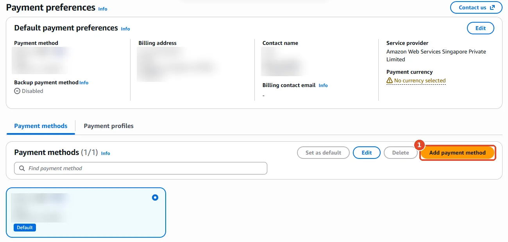
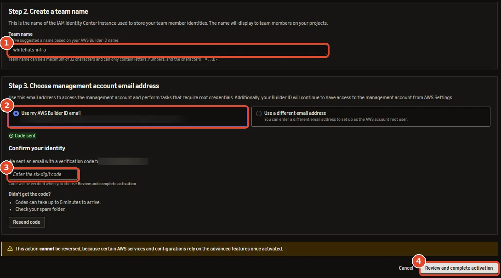
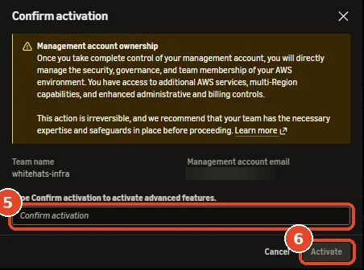
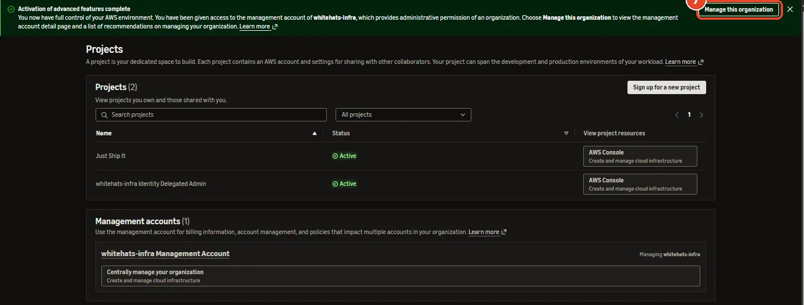
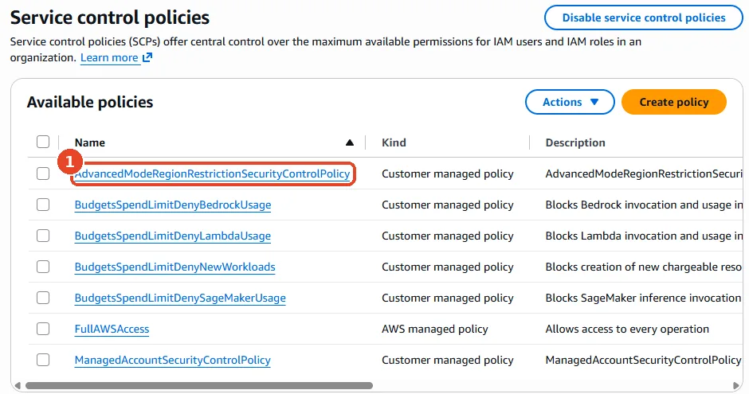
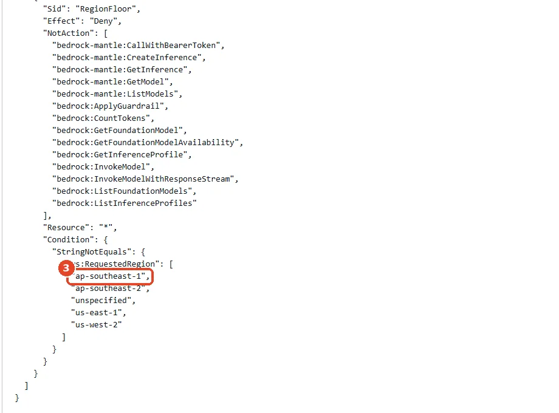

# Prepare the account

Skip this page if your account is a normal Paid-plan account: [Which kind of account you have](aws.md#which-kind-of-account-you-have) shows how to tell. A **Free-plan project** can't run this system until you change three things, all in the browser:

| Change | Why the deploy needs it |
|---|---|
| 1. Upgrade to the **Paid plan** | The Free plan only starts small "Free Tier" computers and can't buy domains |
| 2. **Activate advanced features** | Until then, AWS's own rules block other regions and the permission setup the cluster uses (an *OIDC provider*) |
| 3. Allow **Singapore** in the region rule | The rule still lists only the account's first region |

After step 2, your account sits inside an **AWS organization**: a group of accounts with one account in charge.

<figure class="diagram">
--8<-- "diagrams/org.svg"
<figcaption>Activation creates the management and identity accounts. The project account is the one you already had, and the CTF runs in it. A <b>service control policy (SCP)</b> is a rule the management account sets on the other accounts.</figcaption>
</figure>

!!! danger "Step 2 can't be undone"
    Activation hands you full control of the organization and deletes the Free plan's spend limits. From then on, only your [budget alert](budget.md) warns you about the bill. Set it up the same day.

## 1. Upgrade to the Paid plan

1. Sign in to the [AWS console](https://console.aws.amazon.com/).
2. On **Console Home**, click **Upgrade plan** (box 2 in the [screenshot above](aws.md#which-kind-of-account-you-have)).
3. Read the summary and confirm. AWS charges the card you entered at sign-up; your sign-up credits stay.

**Check it worked:** AWS emails *Your AWS account plan has been upgraded*, and **Manage projects** shows **Current charges** and **Available credits** instead of *Days remaining in free plan*.

To add or change the card later, open **Billing and Cost Management → Payment preferences** in the management account:

<figure class="shot" markdown>

<figcaption>(1) Add payment method. The blurred areas hold the card, billing address and phone number.</figcaption>
</figure>

## 2. Activate advanced features

1. Click **Manage projects** on Console Home. AWS Settings opens.
2. Scroll to **Activate advanced features** and click **Continue to activation**.
3. Fill in the form:

    <figure class="shot" markdown>
    
    <figcaption>(1) A team name, such as <code>whitehats-infra</code>; teammates see it when they sign in. (2) Keep <b>Use my AWS Builder ID email</b>, then click <b>Send verification code</b>. (3) The six-digit code from the email titled <i>Verify the new email address for the AWS account root user</i>. (4) Review and complete activation.</figcaption>
    </figure>

4. Type `Confirm activation` and click **Activate**:

    <figure class="shot" markdown>
    { width="452" }
    <figcaption>(5) Type the two words exactly. (6) Activate.</figcaption>
    </figure>

5. Keep the page open. Activation takes up to 5 minutes, then a green banner appears:

    <figure class="shot" markdown>
    
    <figcaption>The project list now shows your project and a new <i>Identity Delegated Admin</i> account; the management account is listed below them. (7) Manage this organization leads to the next step.</figcaption>
    </figure>

## 3. Allow Singapore

1. Click **Manage this organization**, then **AWS Organizations**. This opens the console of the management account.
2. In the left menu, click **Policies**, then **Service control policies**.

    <figure class="shot" markdown>
    
    <figcaption>(1) The region rule. Leave the other policies alone: <code>ManagedAccountSecurityControlPolicy</code> only protects AWS's own management roles, and the <code>BudgetsSpendLimit…</code> ones only act when a spend limit is set.</figcaption>
    </figure>

3. Open **AdvancedModeRegionRestrictionSecurityControlPolicy** and click **Edit policy**.
4. Scroll to the end of the text, find the list after `"aws:RequestedRegion"` in the statement `"RegionFloor"`, and add `"ap-southeast-1",` as the first entry:

    <figure class="shot" markdown>
    { width="560" }
    <figcaption>(3) The added line. Every region in this list is allowed. The editor reports one error about <code>builderid:*</code>; it comes from AWS's own text, and saving still works.</figcaption>
    </figure>

5. Click **Save changes**. A green banner says *Successfully updated the policy*.

## Check it worked

From the terminal, once you have [signed in](cli-login.md):

```bash
aws ec2 describe-availability-zones --region ap-southeast-1 --query 'AvailabilityZones[].ZoneName' --output text
```

It prints three zone names such as `ap-southeast-1a`. An `explicit deny in a service control policy` error means step 3 didn't save.

## If it fails

| Problem | Fix |
|---|---|
| The activation page says *You must upgrade your account before you can activate advanced features* | Do step 1 first |
| The verification email doesn't arrive | Wait 5 minutes, check spam, then click **Resend code** |
| Commands still get `explicit deny in a service control policy` after step 3 | Read the policy name in the error. If it isn't the region rule, open that policy, and ask the infra lead before you change it |

**Next:** [Sign in from the terminal](cli-login.md).
